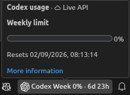
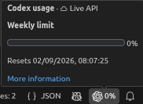
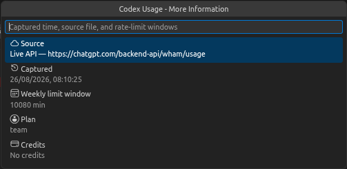

# Codex & Claude Usage for VS Code

A lightweight VS Code extension that shows your OpenAI Codex CLI rate limits
in the status bar, with your Claude Code 5-hour and weekly plan usage right
next to them. It can read local Codex session data offline, or query the
live Codex usage endpoint using the credential you are already logged in with.

This is a fork of
[Ganymede404/vscode-codex-usage](https://github.com/Ganymede404/vscode-codex-usage)
that adds Claude Code usage, published as `samsamhuns.vscode-codex-usage`.

## Features

- Shows each available rate-limit window, usage percentage, and time to reset.
- **Claude Code side by side:** a second status bar item shows Claude Code's
  5-hour session and weekly limits (plus any per-model weekly caps) next to
  Codex, using the Claude Code login you already have.
- **Online or offline:** query the live Codex usage API with your existing
  login, or read local rollout files with no network access at all.
- **Compact or full footer:** show a minimal percent chip or the full
  per-window breakdown.
- Provides usage bars and exact reset times on hover or click.
- **Colour-coded:** each window gets a coloured dot in the status bar
  (🟢 under 50%, 🟡 under 75%, 🟠 under 90%, 🔴 90% and up), and the hover shows
  light, pastel usage badges and bars that stay readable in dark and light
  themes. The status bar itself keeps its normal background.
- Adapts to the windows reported by your plan, including 5-hour, daily,
  weekly, and monthly limits.
- Displays plan, credits, and spend-control information when available.
- Supports current and legacy Codex rollout schemas.

The status bar displays a summary of each window (usage percent and time to
reset):



or, in compact mode, just the Codex logo and a single percent:




## Installation

1. Download the latest `.vsix` file from
   [GitHub Releases](https://github.com/SamSamhuns/vscode-codex-usage/releases).
2. In VS Code, run **Extensions: Install from VSIX...** from the Command
   Palette and select the downloaded file.

VS Code 1.85 or later and an existing Codex CLI session are required.

If the original Codex Usage extension (`ganymede404.vscode-codex-usage`) is
installed, uninstall it first: both register the same commands and settings.

In a remote window (SSH, WSL, or a dev container) the extension runs on the
remote machine, so install it there too. It then reads that machine's
`~/.codex` and Claude Code login, and the Claude item appears once Claude Code
is signed in on that machine.

## How It Works

### Online (API) mode

When you are logged in with the Codex CLI (`codex login`), the extension can
read your live usage directly from Codex's backend. It reads the OAuth access
token and ChatGPT account id already stored in `~/.codex/auth.json` and sends a
read-only `GET` to `https://chatgpt.com/backend-api/wham/usage`. Nothing is
written back, and the login token is never refreshed by this extension — if the
token has expired, run `codex login` (or just use Codex) and the extension picks
up the refreshed token automatically. This endpoint is undocumented and may
change; the extension parses it defensively and falls back to rollout files if
the response does not fit.

### Offline (rollout) mode

Codex CLI writes JSONL rollout files to:

```text
~/.codex/sessions/YYYY/MM/DD/rollout-*.jsonl
```

The extension scans recent rollouts and uses the latest `token_count` event
with rate-limit data. Windows are labeled by their reported duration rather
than by their `primary` or `secondary` slot. Both `resets_at` and the legacy
`resets_in_seconds` field are supported.

### Choosing a source

The `codexUsage.source` setting controls which is used:

- `auto` (default) — query the API when you are logged in, otherwise read
  rollout files.
- `api` — always query the API.
- `rollout` — always read local rollout files (fully offline).

In `auto` and `api` modes, if the live query can't run (not logged in, expired
token, offline) the extension falls back to the latest rollout snapshot and
notes why in the tooltip.

### Claude Code usage

When Claude Code is signed in with a claude.ai plan (Pro, Max, Team, or
Enterprise), a second item, with the Claude logo, appears right next to the
Codex one:

```text
Codex 🟢 5h 12% · 4h 59m  🟡 Week 62% · 4d 2h    Claude 🟢 5h 31% · 2h 9m  🟢 Week 27% · 3d 0h
```

Hover it for usage bars and reset times, including per-model weekly caps
(such as an Opus weekly limit) when your plan has them; click it for the same
menus as Codex. When a Claude per-model cap reaches 75%, it is added to the
status bar text too (e.g. `🔴 Opus weekly 93% · 3d 0h`), so you see it
without hovering.

The data is the same as Claude Code's `/usage`. The extension reads the
claude.ai login Claude Code already stores (the macOS Keychain entry
`Claude Code-credentials`, or `~/.claude/.credentials.json` on Linux and
Windows) and sends a read-only `GET` to
`https://api.anthropic.com/api/oauth/usage`. The login is never refreshed or
written back. If its token has expired, the extension waits for Claude Code to
renew it the next time Claude Code runs.

That endpoint is rate limited per account, and Claude Code's own `/usage` uses
the same allowance, so the extension calls it as rarely as possible:

- One fetch is shared by every VS Code window, through a small state file in
  the extension's global storage.
- Only a focused window fetches, at most every
  `codexUsage.claude.refreshIntervalSeconds` (5 minutes by default). Other
  windows reuse the result, and nothing is fetched while VS Code is in the
  background.
- An expired token is never sent, because the endpoint answers those with a
  long rate-limit cooldown.
- Failures back off exponentially. A `429` response pauses every window,
  manual refreshes included, for as long as the server asks.

The endpoint is undocumented and may change. When a fetch fails, the tooltip
says why and keeps showing the last good data.

## Settings

| Setting | Default | Description |
| --- | --- | --- |
| `codexUsage.source` | `auto` | Data source: `auto`, `api` (online), or `rollout` (offline). |
| `codexUsage.compactStatusBar` | `false` | Show a compact percent chip instead of the full breakdown. |
| `codexUsage.showRemaining` | `false` | Show remaining usage (`% left`) instead of used usage. |
| `codexUsage.colorIndicators` | `true` | Show a coloured dot for each usage window in the status bar and usage menu. |
| `codexUsage.warningBackground` | `false` | Also colour the whole status bar item yellow at 75% used and red at 90%. |
| `codexUsage.statusBarAlignment` | `left` | Which side of the status bar the usage items appear on (`left` or `right`). |
| `codexUsage.codexHome` | `~/.codex` | Codex home directory. |
| `codexUsage.refreshIntervalSeconds` | `60` | How often to refresh the status bar, in seconds. |
| `codexUsage.lookbackDays` | `7` | Number of days to scan for rollout files. |
| `codexUsage.claude.enabled` | `true` | Show Claude Code usage next to Codex. The item only appears when Claude Code is signed in with a claude.ai plan. |
| `codexUsage.claude.refreshIntervalSeconds` | `300` | Minimum time between Claude Code usage fetches (at least 60 seconds). |

The compact, remaining, colour, and alignment settings apply to both items. To hide
just one of them, right-click the status bar and untick **Codex Usage** or
**Claude Code Usage**.

## Commands

| Command | Description |
| --- | --- |
| **Codex & Claude Usage: Refresh** | Refresh Codex and Claude Code usage now. |
| **Codex & Claude Usage: Show Codex Usage** | Open the Codex usage summary. |
| **Codex & Claude Usage: Show Codex More Information** | Show Codex snapshot and account details. |
| **Codex & Claude Usage: Open Codex Sessions Folder** | Reveal the Codex sessions directory. |
| **Codex & Claude Usage: Show Claude Code Usage** | Open the Claude Code usage summary. |
| **Codex & Claude Usage: Show Claude Code More Information** | Show Claude Code plan, extra usage, and limit details. |

**Show Codex More Information** opens a detail view with the snapshot
source, capture time, rate-limit windows, plan, and credits:



## Development

```sh
npm install
npm run compile
```

Press `F5` in VS Code to launch an Extension Development Host.

## Limitations

- Codex `exec` mode may emit `rate_limits: null`. These events are skipped;
  usage remains unavailable until Codex writes a populated event.
- Usage reflects the latest local rollout snapshot and cannot update more
  frequently than Codex writes that data.
- Claude Code usage is only available for claude.ai plan logins. API-key,
  Console, and third-party provider (Bedrock, Vertex, Foundry) setups have no
  plan limits to show, so the Claude item stays hidden.
- Claude Code usage can be up to `codexUsage.claude.refreshIntervalSeconds`
  old, and pauses while Claude Code's login token is expired. A window whose
  reset time has passed shows as reset.
- With a custom `CLAUDE_CONFIG_DIR` on macOS, Claude Code stores its login
  under a different Keychain entry, which the extension doesn't read. It only
  reads that directory's `.credentials.json`.
